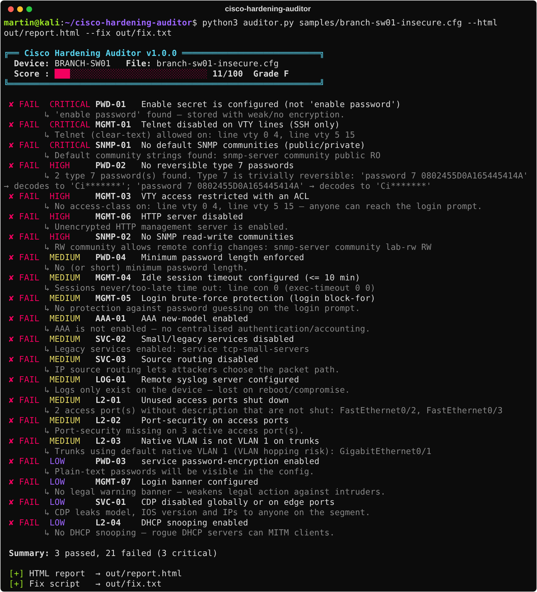
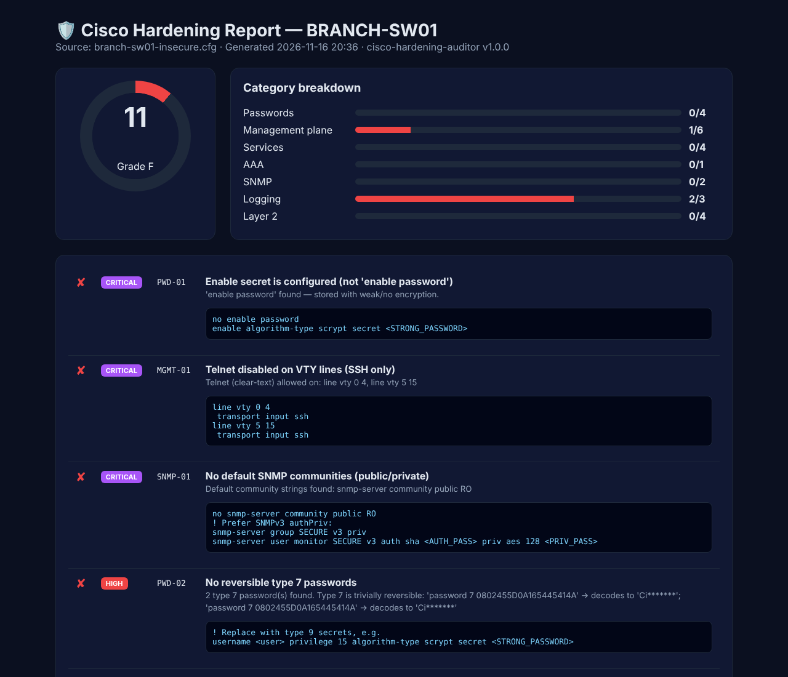
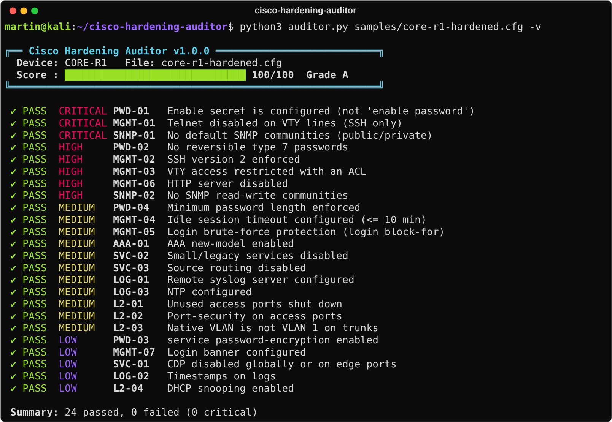

<div align="center">

# 🛡️ Cisco Hardening Auditor

**Offline security audit for Cisco IOS / IOS-XE configurations: score, explain, fix.**




</div>

---

## 📖 What is this?

Misconfigured routers and switches are one of the easiest ways into a network: Telnet left on,
`snmp-server community public`, type 7 passwords anyone can decode in a second, trunks on native VLAN 1...

**Cisco Hardening Auditor** reads a saved `show running-config` and checks it against **24 hardening
rules** grouped into 7 categories. For every device, it produces:

| Output | Description |
|---|---|
| 🖥️ **Terminal report** | Coloured PASS/FAIL list sorted by severity, with a 0–100 score and A–F grade |
| 🌐 **HTML report** | Self-contained dashboard (score ring, category breakdown, fix commands) you can send to a manager |
| 🔧 **Remediation script** | Ready-to-review IOS commands that fix every failed check |
| 🤖 **JSON + exit codes** | For CI pipelines: fail a build if a config drops below a minimum score |

It never connects to a device and needs no credentials. It only reads text files, so it's safe to run anywhere.

## ✨ Features

- **Password security:** `enable password` vs `enable secret`, type 5/9 hashes, min-length, and
  **type 7 decoding** that proves the risk (output is masked, e.g. `Ci*******`)
- **Management plane:** Telnet vs SSH, SSHv2, VTY ACLs, exec-timeout, `login block-for`, HTTP server, banners
- **SNMP:** default `public`/`private` communities, RW communities, and a suggested SNMPv3 replacement
- **Services:** CDP, small servers, finger, BOOTP, IP source-routing
- **Logging:** remote syslog, timestamps, NTP
- **Layer 2:** unused open ports, port-security, native VLAN 1 on trunks, DHCP snooping
- **Weighted scoring:** CRITICAL = 10, HIGH = 7, MEDIUM = 4, LOW = 2
- **Batch mode:** audit a whole folder of configs at once
- **Zero dependencies:** pure Python standard library

## 📸 Screenshots

<table>
<tr>
<td width="50%"><b>HTML report</b><br></td>
<td width="50%"><b>Hardened router (verbose mode, 100/100)</b><br></td>
</tr>
</table>

---

## 🚀 Tutorial

### 1. Install

```bash
git clone https://github.com/Martun1/cisco-hardening-auditor.git
cd cisco-hardening-auditor
python3 auditor.py --help        # Python 3.10+ is all you need
```

### 2. Export a config from your device

On the router or switch (or in Packet Tracer / GNS3 / EVE-NG):

```
R1# terminal length 0
R1# show running-config
```

Copy the output into a text file such as `r1.cfg`. You can also use TFTP:

```
R1# copy running-config tftp://10.0.99.10/r1.cfg
```

### 3. Run your first audit

```bash
python3 auditor.py samples/branch-sw01-insecure.cfg
```

Failed checks are listed first, the most severe at the top. Add `-v` to also list passed checks.

### 4. Generate the HTML report and the fix script

```bash
python3 auditor.py r1.cfg --html report.html --fix r1-fix.txt
```

Open `report.html` in your browser. `r1-fix.txt` looks like this:

```
configure terminal
! --- MGMT-01: Telnet disabled on VTY lines (SSH only)
line vty 0 4
 transport input ssh
! --- SNMP-01: No default SNMP communities (public/private)
no snmp-server community public RO
...
end
write memory
```

> ⚠️ **Always review the script and test it in a lab before you apply it.** Replace every `<PLACEHOLDER>`,
> and make sure SSH works before you disable Telnet, or you can lock yourself out.

### 5. Audit a whole network

```bash
python3 auditor.py configs/*.cfg --html reports/ --fix fixes/
```

This writes one HTML report and one fix script per hostname.

### 6. Use it in CI/CD (config-as-code)

```bash
python3 auditor.py configs/*.cfg --min-score 80 --json > audit.json
echo $?   # 0 = all good, 2 = at least one device below 80
```

This repository's own [GitHub Actions workflow](.github/workflows/ci.yml) runs the unit tests and
fails the build if the hardened sample scores below 90.

---

## 🧪 Lab exercise: from F to A

1. Build a switch in Packet Tracer and paste in [`samples/branch-sw01-insecure.cfg`](samples/branch-sw01-insecure.cfg).
2. Run the auditor. It scores **11/100 (F)**.
3. Apply the generated fix script step by step, re-running the auditor after each section.
4. Compare your result with [`samples/core-r1-hardened.cfg`](samples/core-r1-hardened.cfg), which scores **100/100**.

## 🗂️ Check reference

| ID | Check | Severity |
|---|---|---|
| PWD-01 | enable secret instead of enable password | CRITICAL |
| PWD-02 | No reversible type 7 passwords | HIGH |
| PWD-03 | service password-encryption | LOW |
| PWD-04 | Minimum password length ≥ 10 | MEDIUM |
| MGMT-01 | VTY transport SSH only | CRITICAL |
| MGMT-02 | SSH version 2 | HIGH |
| MGMT-03 | access-class on VTY lines | HIGH |
| MGMT-04 | exec-timeout ≤ 10 min | MEDIUM |
| MGMT-05 | login block-for | MEDIUM |
| MGMT-06 | HTTP server disabled | HIGH |
| MGMT-07 | Login banner | LOW |
| AAA-01 | aaa new-model | MEDIUM |
| SNMP-01 | No public/private communities | CRITICAL |
| SNMP-02 | No RW communities | HIGH |
| SVC-01 | CDP disabled | LOW |
| SVC-02 | Legacy small services off | MEDIUM |
| SVC-03 | no ip source-route | MEDIUM |
| LOG-01 | Remote syslog | MEDIUM |
| LOG-02 | Log timestamps | LOW |
| LOG-03 | NTP | MEDIUM |
| L2-01 | Unused access ports shut | MEDIUM |
| L2-02 | Port-security | MEDIUM |
| L2-03 | Native VLAN ≠ 1 | MEDIUM |
| L2-04 | DHCP snooping | LOW |

### Adding your own check

Each check is a small decorated function, so it's easy to extend:

```python
@check("SVC-04", "No IP redirects on WAN", "LOW", "Services")
def _(c: IOSConfig):
    if c.has(r"^ no ip redirects"):
        return True, "Redirects disabled.", []
    return False, "ICMP redirects enabled.", ["interface <wan>\n no ip redirects"]
```

## 🧱 Project structure

```
cisco-hardening-auditor/
├── auditor.py                 # parser, checks, scoring, reports (single file)
├── samples/                   # insecure + hardened lab configs
├── tests/test_auditor.py      # unit tests (python -m unittest)
├── docs/                      # screenshots
└── .github/workflows/ci.yml   # CI pipeline
```

## 🗺️ Roadmap

- [ ] ASA / NX-OS support
- [ ] Pull configs over SSH with Netmiko (optional dependency)
- [ ] Map checks to CIS Benchmark IDs
- [ ] Diff mode: compare two config versions

## ⚖️ Disclaimer

For **auditing configurations you own or are authorized to assess**. The type 7 decoder exists to
demonstrate why type 7 must not be used. Recommendations follow common best practice (Cisco hardening
guides, CIS benchmarks) but always validate them for your environment.

---

<div align="center">
Made by <a href="https://github.com/Martun1">Martin Ivanov</a> · CCNA · eJPT · Computer Science @ NBU
</div>
